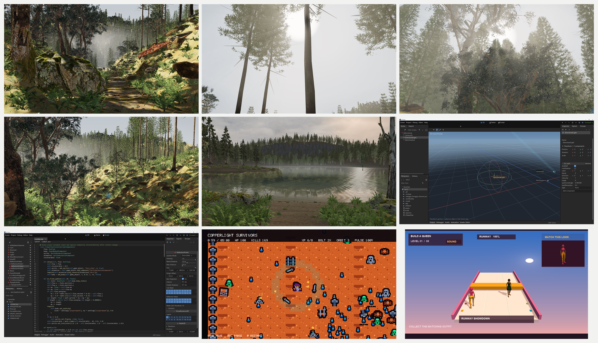

# arp-engine

<p align="center">
  
</p>

> AI Render Pipeline — an AI Native engine built for agents to author, run, inspect, and customize.

[](LICENSE)
[](#why-ai-native)
[](CMakeLists.txt)
[](CMakePresets.json)
[](https://shader-slang.com/)
[](RHI_CAPABILITY_MATRIX.md)
[](RHI_CAPABILITY_MATRIX.md)
[](RHI_CAPABILITY_MATRIX.md)
[](#webgl1-prototype)
[](docs/platform-build-matrix.md)

**ARP (AI Render Pipeline)** is an open-source, cross-platform **AI Native game engine** built in C++17. Its editor interfaces, text-based asset authoring, script execution, and modular kernel are designed to let AI agents work across the development loop: understand a project, edit its content and behavior, run it, inspect results, and customize the engine itself.

<a id="english"></a>



[English](#english) | [简体中文](#简体中文)

## Why AI Native

### 1. An editor designed for AI agents

CLI and MCP are first-class editor interfaces. The native editor, ArpScript-driven CLI, REST API, and MCP endpoint share the same editor command dispatcher, so agents can query state and perform supported authoring operations through explicit commands. The editor builds on ARP's native cross-platform windowing and rendering layers, with a browser-hosted version that agents can open in their built-in browser to preview and inspect the editor UI.

See the [editor CLI and MCP workflow](editor/README.md#native-desktop), [browser editor](editor/README.md#webgl-browser-editor-explicit-prototype), and [platform build matrix](docs/platform-build-matrix.md).

### 2. Assets that AI can read and edit as text

Internal asset definitions, metadata, UI authoring, and resource configuration use **YAML**, giving agents readable, diffable inputs for generation, review, and deterministic validation. Text authoring describes asset meaning and bindings; imported models, textures, audio, and cooked runtime payloads can still be binary. Explicit schemas, versions, and resource identities connect those payloads to their authoring definitions.

Shaders are code authored in **Slang**, with no Shader Graph authoring layer. A single shader language feeds target compilation and reflection, so agents can edit and review shader logic directly alongside engine code. See the [resource package implementation](src/resource/internal_asset_package.h), [editor authoring assets](editor/resources/), and [shader build tool](scripts/compile_shaders.py).

### 3. Script-driven iteration with a native compilation path

**ArpScript combines AOT compilation and Interpreter execution** to support fast iteration and performance-oriented delivery. Interpreter execution serves interactive tooling and editor hot updates; the AOT v5 path lowers validated Typed IR to DirectNative code. This gives script-driven development a native compilation path for supported code, while retaining interpreted execution where iteration needs it.

The two paths cooperate through explicit execution contracts and bridges, with shared Typed IR semantics connecting authoring, compilation, and execution. See the [Typed IR backend contract](docs/scriptvm/typed_ir_backend_contract.md) and [AOT/Interpreter implementation and validation](docs/scriptvm/aot_v5_windows_web_status.md).

### 4. A lightweight, open kernel that agents can understand and customize

ARP uses a modular C++17 kernel with explicit responsibility and dependency boundaries. Under the **MIT license**, engine source is available for inspection, modification, and redistribution. Agents can follow a feature from authoring and scripts through resources, runtime, rendering, and backend implementation, then make changes at the layer that owns the behavior.

Combine the source with **CodeGraph** indexing to navigate symbols, callers, and dependencies when investigating or extending the engine. Clear module ownership and executable contracts give agents concrete context for deeper customization. See the [engine modules](src/), [contract and smoke tests](tests/), and [module-boundary guidance](AGENTS.md#模块归属与-core-边界). CodeGraph is a separate development tool used with an indexed checkout.

## Try the browser editor

With Emscripten and the native reflection/script compiler tools installed:

```powershell
python scripts/build.py editor-webgl
python scripts/serve_editor_web.py
```

Open `http://127.0.0.1:8093/arp_editor.html` in your agent's built-in browser. See the [editor instructions](editor/README.md#webgl-browser-editor-explicit-prototype) for setup and workspace import/export.

## What's in the repository

- **RHI and rendering**: shared RHI semantics and backend lowering for Null, Vulkan, Metal, and WebGPU; renderer and RenderGraph modules; shader reflection and contract tests.
- **Runtime and engine services**: core math and CPU allocation, platform/window lifecycle, resources and assets, scene and entity components, input, networking, physics, animation, terrain, audio, and procedural-generation modules.
- **Scripting**: ArpScript ScriptVM, Interpreter execution and editor hot updates, DirectNative AOT tooling, and generated reflection/plugin bindings.
- **UI and tools**: retained engine UI in `src/ui/`, the standard ARP Editor with CLI/REST/MCP interfaces and a browser Prototype in `editor/`, command-line and import tools under `tools/`, plus examples and game targets.
- **Shaders**: Slang sources are authoritative. The build generates target artifacts and YAML reflection metadata.
- **WebGL1 Prototype**: an isolated runtime component, shader probes, and a browser editor authoring path.

<a id="webgl1-prototype"></a>

The repository also includes third-party dependencies under `3rd/`. See [modules/README.md](modules/README.md) for ScriptVM import plugins and [editor/README.md](editor/README.md) for editor capabilities and workflows.

## RHI and shader contracts

RHI work follows this order: define L2 semantics and invariants, specify versioned lowering for each backend, implement backend-private execution, then integrate with renderer/RenderGraph and higher layers.

Null provides contract validation; Vulkan, Metal, and WebGPU implement the shared RHI through backend-specific lowering. The [capability matrix](RHI_CAPABILITY_MATRIX.md) records per-feature lowering policies and backend/platform validation evidence.

Shaders are authored in Slang. Cross-language matrix layout and shader reflection are tested contracts; see the matrix-layout section in [AGENTS.md](AGENTS.md) before changing shader interfaces. Build outputs are placed in the selected CMake build directory, normally `build/<preset>/shaders/`; reflection metadata uses YAML.

## Repository layout

```text
src/                  Engine modules: core, RHI, renderer, platform, runtime, tools
modules/              ScriptVM plugin modules and module documentation
shaders/              Engine Slang shader sources and shader fixtures
editor/               Standard ARP Editor application
examples/             Example applications and workflows
tests/                Contract, unit, integration, smoke, visual, and tooling tests
tools/                Build, shader, import, reflection, and validation tools
cmake/                CMake helpers and focused target definitions
docs/                 Architecture, contracts, plans, and validation notes
3rd/                  Vendored third-party dependencies
```

## Build on Windows

The supported local Windows workflow uses CMake, Ninja, MinGW-w64, Python, the Vulkan SDK, and Slang. The checked-in Windows presets are `win-vulkan-debug` and `win-vulkan-release`; the web presets are `web-webgpu-debug` and `web-webgpu-release`. See [docs/platform-build-matrix.md](docs/platform-build-matrix.md) for other targets and their SDK requirements.

The repository build orchestrator defaults to `win-vulkan-debug`:

```powershell
# Configure and build the engine plus the standard editor
python scripts/build.py --preset win-vulkan-debug configure
python scripts/build.py --preset win-vulkan-debug engine

# Build shader artifacts, or a game target
python scripts/build.py --preset win-vulkan-debug shaders
python scripts/build.py --preset win-vulkan-debug game wocc

# Build the orchestrator's focused smoke suite
python scripts/build.py --preset win-vulkan-debug test
```

`engine` includes `arp_engine` and, by default, `arp_editor`. Use `engine --no-editor` for an engine-only target when the CMake configuration has `ARP_BUILD_EDITOR=OFF`. `game` accepts `survivors`, `pika`, `wocc`, `project-lane`, `material-editor`, `character-viewer`, `stylized-showcase`, `production-demo`, `splash-boot`, and `clear-sample`; `game all` builds all registered targets. `all --with-games` builds the engine, editor, shaders, and registered game targets.

For the complete CTest suite after configuring and building its targets, use:

```powershell
cmake --build --preset win-vulkan-debug
ctest --preset win-vulkan-debug
```

Build outputs reside under `build/win-vulkan-debug/` (or the selected preset directory). Shader outputs are under its `shaders/` subdirectory. The exact targets and tests vary by platform and configuration.

## Useful documentation

- [RHI Capability Matrix](RHI_CAPABILITY_MATRIX.md): per-feature backend lowering and evidence.
- [Platform Build Matrix](docs/platform-build-matrix.md): presets, SDKs, and validation order.
- [ARP Editor](editor/README.md): editor capabilities and workflows.
- [ScriptVM modules](modules/README.md): plugin and reflection contracts.
- [AI Development Constraints](AGENTS.md): repository engineering and validation requirements.

## Readiness vocabulary

| Status | Meaning |
| --- | --- |
| **Contract Complete** | The intended behavior and its contract-level checks are defined. |
| **Prototype Complete** | A working implementation is complete within its defined prototype scope. |
| **Backend Validated** | The behavior was exercised through the named real backend. |
| **Platform Validated** | The behavior was tested on the named target platform. |
| **Production Ready** | Required backend, platform, lifecycle, resource, and runtime evidence is complete for the stated scope. |

## License

MIT. See [LICENSE](LICENSE).

---

<a id="简体中文"></a>

# arp-engine

> AI Render Pipeline — 面向 AI Agent 创作、运行、检查与定制的 AI Native 引擎。

**ARP（AI Render Pipeline）** 是一个基于 C++17、完全开源的跨平台 **AI Native 游戏引擎**。从编辑器接口、文本资产、脚本执行到模块化内核，ARP 围绕 AI Agent 的开发方式设计，让 AI 能够贯穿理解项目、编辑内容与逻辑、运行、检查结果和定制引擎的完整开发流程。

[English](#english) | [简体中文](#简体中文)

## 为什么是 AI Native

### 1. 面向 AI 的编辑器

CLI 和 MCP 是编辑器的一等接口。原生编辑器、ArpScript 驱动的 CLI、REST API 与 MCP 端点共享同一个编辑器命令分发器，Agent 可以通过明确的命令查询状态、执行已支持的编辑操作。编辑器基于 ARP 原生跨平台窗口与渲染层构建，并提供浏览器版本，Agent 可以直接用内置浏览器打开，预览和检查编辑器 UI。

入口见[编辑器 CLI 与 MCP 工作流](editor/README.md#native-desktop)、[浏览器编辑器](editor/README.md#webgl-browser-editor-explicit-prototype)及[平台构建矩阵](docs/platform-build-matrix.md)。

### 2. 面向文本编辑的资产体系

内部资产定义、元数据、UI 编排和资源配置统一采用 **YAML**，让 AI 可以直接读取、生成、修改、比较差异，并通过确定性校验检查结果。文本层表达资产语义与绑定关系；导入的模型、纹理、音频及 cook 后的运行时载荷仍可采用二进制格式，通过显式 schema、版本和资源身份与文本定义关联。

Shader 摒弃 Shader Graph，统一采用 **Slang 源码**编写，并由同一语言生成各目标产物与 reflection。AI 可以像修改其他代码一样直接理解、修改和审查 shader 逻辑。相关入口：[资源包实现](src/resource/internal_asset_package.h)、[编辑器创作资产](editor/resources/)、[shader 构建工具](scripts/compile_shaders.py)。

### 3. 脚本驱动，兼顾迭代效率与原生编译

**ArpScript 结合 AOT 与 Interpreter 两种执行模式**，让脚本驱动同时具备快速迭代和面向性能的交付路径。Interpreter 用于交互式工具与编辑器热更新；AOT v5 将经过验证的 Typed IR 编译为 DirectNative 代码。受支持的脚本可以进入原生编译路径，需要快速迭代的环节则保留解释执行能力。

两种执行路径通过显式执行契约和桥接协作，以共享的 Typed IR 语义衔接创作、编译与执行。详见 [Typed IR 后端契约](docs/scriptvm/typed_ir_backend_contract.zh-CN.md)及 [AOT/Interpreter 实现与验证](docs/scriptvm/aot_v5_windows_web_status.md)。

### 4. 轻量化、完全开源、便于 AI 深入定制的内核

ARP 采用职责与依赖边界明确的模块化 C++17 内核，以 **MIT 许可证**开放引擎源码，支持检查、修改与再分发。AI 可以沿着编辑器、脚本、资源、运行时、渲染器到后端追踪完整实现，并在真正拥有该语义的模块内完成定制。

结合 **CodeGraph** 索引，AI 可以进一步追踪符号、调用方和依赖关系，理解引擎底层。清晰的模块归属与可执行契约，为深度定制提供可核对的上下文。相关入口：[引擎模块](src/)、[契约与 smoke 测试](tests/)、[模块边界约束](AGENTS.md#模块归属与-core-边界)。CodeGraph 是配合已索引仓库使用的独立开发工具。

## 用 Agent 浏览器体验编辑器

安装 Emscripten 并准备好原生 reflection/script compiler 工具后：

```powershell
python scripts/build.py editor-webgl
python scripts/serve_editor_web.py
```

在 Agent 内置浏览器中打开 `http://127.0.0.1:8093/arp_editor.html`。环境准备与工作区导入/导出见[编辑器说明](editor/README.md#webgl-browser-editor-explicit-prototype)。

## 仓库内容

- **RHI 与渲染**：Null、Vulkan、Metal、WebGPU 的共享 RHI 语义和后端 lowering；渲染器、RenderGraph、shader reflection 与契约测试。
- **运行时与引擎服务**：core 数学和 CPU allocator、平台/窗口生命周期、资源与资产、场景和实体组件、输入、网络、物理、动画、地形、音频和程序化生成模块。
- **脚本**：ArpScript ScriptVM、Interpreter 执行与编辑器热更新、DirectNative AOT 工具、生成式反射/插件绑定。
- **UI 与工具**：`src/ui/` 中的引擎保留模式 UI、`editor/` 下具备 CLI/REST/MCP 接口和浏览器 Prototype 的标准 ARP Editor、`tools/` 下的命令行及导入工具，以及示例和游戏目标。
- **Shader**：Slang 是唯一权威源码。构建生成目标产物与 YAML reflection 元数据。
- **WebGL1 Prototype**：独立运行时组件、shader 探测工具及浏览器编辑器创作路径。

仓库在 `3rd/` 中包含第三方依赖。ScriptVM 导入插件见 [modules/README.md](modules/README.md)；编辑器能力与工作流见 [editor/README.md](editor/README.md)。

## RHI 与 Shader 契约

RHI 改动按以下顺序实施：定义 L2 语义和不变量；为各后端规定有版本的 lowering；实现后端私有执行；最后接入 renderer/RenderGraph 和上层。

Null 提供契约验证；Vulkan、Metal 和 WebGPU 通过各自的 lowering 实现共享 RHI。[能力矩阵](RHI_CAPABILITY_MATRIX.md)记录各项功能的 lowering 策略与后端、平台验证证据。

Shader 使用 Slang 编写。跨语言矩阵布局和 shader reflection 是受测试的契约；修改 shader 接口前请先阅读 [AGENTS.md](AGENTS.md) 中的 Matrix Layout 约束。构建产物写入所选 CMake build 目录，通常为 `build/<preset>/shaders/`；reflection 元数据使用 YAML。

## 目录结构

```text
src/                  引擎模块：core、RHI、renderer、platform、runtime、tools
modules/              ScriptVM 插件模块及其文档
shaders/              引擎 Slang shader 源码和 shader fixtures
editor/               标准 ARP Editor 应用
examples/             示例应用和工作流
tests/                契约、单元、集成、smoke、可视化和工具测试
tools/                构建、shader、导入、反射和验证工具
cmake/                CMake helpers 和专项 target 定义
docs/                 架构、契约、计划和验证记录
3rd/                  vendored 第三方依赖
```

## Windows 构建

本地 Windows 工作流使用 CMake、Ninja、MinGW-w64、Python、Vulkan SDK 和 Slang。仓库内 Windows preset 为 `win-vulkan-debug`、`win-vulkan-release`；Web preset 为 `web-webgpu-debug`、`web-webgpu-release`。其他平台的 preset 和 SDK 要求见[平台构建矩阵](docs/platform-build-matrix.md)。

构建脚本默认使用 `win-vulkan-debug`：

```powershell
# 配置并构建引擎与标准编辑器
python scripts/build.py --preset win-vulkan-debug configure
python scripts/build.py --preset win-vulkan-debug engine

# 构建 shader 产物，或一个游戏目标
python scripts/build.py --preset win-vulkan-debug shaders
python scripts/build.py --preset win-vulkan-debug game wocc

# 构建脚本提供的 focused smoke 测试集
python scripts/build.py --preset win-vulkan-debug test
```

`engine` 默认包含 `arp_engine` 和 `arp_editor`。若 CMake 配置使用 `ARP_BUILD_EDITOR=OFF`，可通过 `engine --no-editor` 只构建引擎。`game` 支持 `survivors`、`pika`、`wocc`、`project-lane`、`material-editor`、`character-viewer`、`stylized-showcase`、`production-demo`、`splash-boot` 和 `clear-sample`；`game all` 构建所有已注册目标。`all --with-games` 会构建引擎、编辑器、shader 和全部已注册游戏目标。

完成配置并构建测试目标后，可运行完整 CTest 集：

```powershell
cmake --build --preset win-vulkan-debug
ctest --preset win-vulkan-debug
```

构建产物位于 `build/win-vulkan-debug/`（或所选 preset 对应目录），shader 产物位于其中的 `shaders/`。具体可用 target 和测试会因平台及配置而异。

## 相关文档

- [RHI 能力矩阵](RHI_CAPABILITY_MATRIX.md)：各后端的 feature lowering 与证据。
- [平台构建矩阵](docs/platform-build-matrix.md)：preset、SDK 和验证顺序。
- [ARP Editor](editor/README.md)：编辑器能力与工作流。
- [ScriptVM modules](modules/README.md)：插件及反射契约。
- [AI Development Constraints](AGENTS.md)：仓库工程约束和验证要求。

## 就绪状态术语

| 状态 | 含义 |
| --- | --- |
| **Contract Complete** | 预期行为及契约层检查已有定义。 |
| **Prototype Complete** | 已在定义的原型范围内完成可运行实现。 |
| **Backend Validated** | 已通过指定的真实后端执行验证。 |
| **Platform Validated** | 已在指定目标平台测试。 |
| **Production Ready** | 对声明范围所需的后端、平台、生命周期、资源和运行时证据均已完成。 |

## 许可证

MIT，详见 [LICENSE](LICENSE)。
