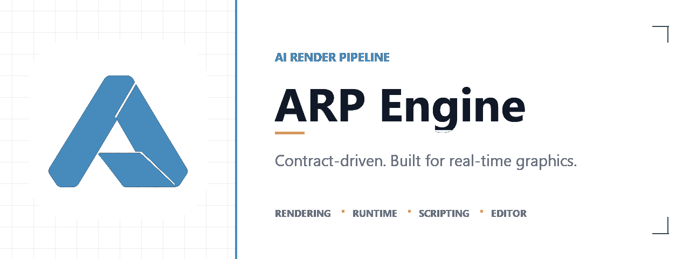

# arp-engine

<p align="center">
  
</p>

> AI Render Pipeline - a contract-driven, cross-platform engine and rendering framework.

[](LICENSE)
[](CMakeLists.txt)
[](CMakePresets.json)
[](https://shader-slang.com/)
[](RHI_CAPABILITY_MATRIX.md)
[](RHI_CAPABILITY_MATRIX.md)
[](RHI_CAPABILITY_MATRIX.md)
[](#webgl1-prototype)
[](docs/platform-build-matrix.md)

**ARP (AI Render Pipeline)** is a C++17 engine and rendering framework. It combines a contract-driven RHI and renderer with runtime, resource, scripting, UI, platform, and authoring-tool modules. Windows/Vulkan is the primary local development path; other targets are at different implementation and validation stages.

<a id="english"></a>

[English](#english) | [简体中文](#简体中文)

## Project status

This repository contains active engine development, prototypes, backend implementations, and platform build configurations. A configured or compiling target does not by itself mean its backend or platform is validated. Read the [RHI capability matrix](RHI_CAPABILITY_MATRIX.md) and [platform build matrix](docs/platform-build-matrix.md) for current, feature-specific evidence. The project does not claim that every feature is Production Ready.

## What's in the repository

- **RHI and rendering**: shared RHI semantics and backend lowering for Null, Vulkan, Metal, and WebGPU; renderer and RenderGraph modules; shader reflection and contract tests.
- **Runtime and engine services**: core math and CPU allocation, platform/window lifecycle, resources and assets, scene and entity components, input, networking, physics, animation, terrain, audio, and procedural-generation modules.
- **Scripting**: ArpScript ScriptVM, generated reflection/plugin bindings, and AOT tooling. Interpreter, AOT, and platform support have their own validation boundaries.
- **UI and tools**: retained engine UI in `src/ui/`, the standard ARP Editor in `editor/`, command-line and import tools under `tools/`, plus examples and game targets.
- **Shaders**: Slang sources are authoritative. The build generates target artifacts and reflection metadata; unsupported target forms may produce explicit diagnostics rather than an artifact.
- **WebGL1**: an isolated runtime component and shader probes are available through explicit tooling. This is a Prototype/feasibility path, not a fifth production RHI backend or a general production capability.

<a id="webgl1-prototype"></a>

The repository also includes third-party dependencies under `3rd/`. See [modules/README.md](modules/README.md) for ScriptVM import plugins and [editor/README.md](editor/README.md) for editor scope and limitations.

## RHI and shader contracts

RHI work follows this order: define L2 semantics and invariants, specify versioned lowering for each backend, implement backend-private execution, then integrate with renderer/RenderGraph and higher layers. Unsupported or non-equivalent behavior must fail with a deterministic diagnostic or require an explicitly opted-in prototype/legacy path.

Null is primarily a validation backend; it is not evidence of native GPU execution. Likewise, source code, a CMake preset, generated shader, or passing contract test is not by itself evidence of backend or platform validation. The capability matrix records lowering policy and validation evidence separately.

Shaders are authored in Slang. Cross-language matrix layout and shader reflection are checked by the contract tests in `tests/contract/shader_tests.cpp`. Build outputs are placed in the selected CMake build directory, normally `build/<preset>/shaders/`; reflection metadata uses YAML.

## Repository layout

```text
src/                  Engine modules: core, RHI, renderer, platform, runtime, tools
modules/              ScriptVM plugin modules and module documentation
shaders/              Engine Slang shader sources and shader fixtures
editor/               Standard ARP Editor application
examples/             Example applications and workflows
tests/                Contract, unit, integration, smoke, visual, and tooling tests
tools/                Build, shader, import, reflection, and validation tools
cmake/                CMake helpers and focused target definitions
docs/                 Architecture, contracts, plans, and validation notes
3rd/                  Vendored third-party dependencies
```

## Build on Windows

The supported local Windows workflow uses CMake, Ninja, MinGW-w64, Python, the Vulkan SDK, and Slang. The checked-in Windows presets are `win-vulkan-debug` and `win-vulkan-release`; the web presets are `web-webgpu-debug` and `web-webgpu-release`. See [docs/platform-build-matrix.md](docs/platform-build-matrix.md) for other targets and their SDK requirements.

The repository build orchestrator defaults to `win-vulkan-debug`:

```powershell
# Configure and build the engine plus the standard editor
python scripts/build.py --preset win-vulkan-debug configure
python scripts/build.py --preset win-vulkan-debug engine

# Build shader artifacts, or a game target
python scripts/build.py --preset win-vulkan-debug shaders
python scripts/build.py --preset win-vulkan-debug game wocc

# Build the orchestrator's focused smoke suite
python scripts/build.py --preset win-vulkan-debug test
```

`engine` includes `arp_engine` and, by default, `arp_editor`. Use `engine --no-editor` for an engine-only target when the CMake configuration has `ARP_BUILD_EDITOR=OFF`. `game` accepts `survivors`, `pika`, `wocc`, `project-lane`, `material-editor`, `character-viewer`, `stylized-showcase`, `production-demo`, `splash-boot`, and `clear-sample`; `game all` builds all registered targets. `all --with-games` builds the engine, editor, shaders, and registered game targets.

For the complete CTest suite after configuring and building its targets, use:

```powershell
cmake --build --preset win-vulkan-debug
ctest --preset win-vulkan-debug
```

Build outputs reside under `build/win-vulkan-debug/` (or the selected preset directory). Shader outputs are under its `shaders/` subdirectory. The exact targets and tests vary by platform and configuration.

## Useful documentation

- [RHI Capability Matrix](RHI_CAPABILITY_MATRIX.md): per-feature backend lowering and evidence.
- [Platform Build Matrix](docs/platform-build-matrix.md): presets, SDKs, and validation order.
- [ARP Editor](editor/README.md): editor capabilities, workflows, and prototype limits.
- [ScriptVM modules](modules/README.md): plugin and reflection contracts.
- [RHI Capability Matrix](RHI_CAPABILITY_MATRIX.md): backend lowering boundaries and status.
- [Platform Build Matrix](docs/platform-build-matrix.md): configured platform build paths.

## Readiness vocabulary

| Status | Meaning |
| --- | --- |
| **Contract Complete** | The intended behavior and its contract-level checks are defined. |
| **Prototype Complete** | A bounded implementation path works; broader guarantees are not implied. |
| **Backend Validated** | The behavior was exercised through the named real backend. |
| **Platform Validated** | The behavior was tested on the named target platform. |
| **Production Ready** | Required backend, platform, lifecycle, resource, and runtime evidence is complete for the stated scope. |

## License

MIT. See [LICENSE](LICENSE).

---

<a id="简体中文"></a>

# arp-engine

> AI Render Pipeline - 契约驱动的跨平台引擎与渲染框架。

**ARP（AI Render Pipeline）** 是一个基于 C++17 的引擎与渲染框架，包含契约驱动的 RHI、渲染器、运行时、资源、脚本、UI、平台和编辑器模块。Windows/Vulkan 是主要本地开发路径；其他目标处于不同的实现与验证阶段。

[English](#english) | [简体中文](#简体中文)

## 项目状态

仓库同时包含持续开发中的引擎能力、原型、后端实现和平台构建配置。目标已配置或代码可编译，并不代表对应后端或平台已经验证。具体功能的策略和证据请查看 [RHI 能力矩阵](RHI_CAPABILITY_MATRIX.md) 与[平台构建矩阵](docs/platform-build-matrix.md)。项目不宣称所有功能均已达到 Production Ready。

## 仓库内容

- **RHI 与渲染**：Null、Vulkan、Metal、WebGPU 的共享 RHI 语义和后端 lowering；渲染器、RenderGraph、shader reflection 与契约测试。
- **运行时与引擎服务**：core 数学和 CPU allocator、平台/窗口生命周期、资源与资产、场景和实体组件、输入、网络、物理、动画、地形、音频和程序化生成模块。
- **脚本**：ArpScript ScriptVM、生成式反射/插件绑定和 AOT 工具。解释器、AOT 与平台能力有各自的验证边界。
- **UI 与工具**：`src/ui/` 中的引擎保留模式 UI、`editor/` 下的标准 ARP Editor、`tools/` 下的命令行及导入工具，以及示例和游戏目标。
- **Shader**：Slang 是唯一权威源码。构建会生成目标产物和 reflection 元数据；不支持的目标形式可能给出明确诊断，而不是生成产物。
- **WebGL1**：仓库提供独立运行时组件和 shader 探测工具，需通过显式工具路径启用。它属于 Prototype/可行性验证，不是第五个生产 RHI 后端，也不代表通用生产能力。

仓库在 `3rd/` 中包含第三方依赖。ScriptVM 导入插件见 [modules/README.md](modules/README.md)；编辑器范围和限制见 [editor/README.md](editor/README.md)。

## RHI 与 Shader 契约

RHI 改动按以下顺序实施：定义 L2 语义和不变量；为各后端规定有版本的 lowering；实现后端私有执行；最后接入 renderer/RenderGraph 和上层。无法支持或无法保持语义等价的行为，必须返回确定性诊断，或要求调用方显式选择 Prototype/Legacy 路径。

Null 主要用于验证，不代表 GPU 原生执行。源码存在、CMake preset 存在、shader 已生成或契约测试通过，也都不能单独证明后端或平台已验证。能力矩阵分别记录 lowering 策略与验证证据。

Shader 使用 Slang 编写。跨语言矩阵布局和 shader reflection 由 `tests/contract/shader_tests.cpp` 中的契约测试约束。构建产物写入所选 CMake build 目录，通常为 `build/<preset>/shaders/`；reflection 元数据使用 YAML。

## 目录结构

```text
src/                  引擎模块：core、RHI、renderer、platform、runtime、tools
modules/              ScriptVM 插件模块及其文档
shaders/              引擎 Slang shader 源码和 shader fixtures
editor/               标准 ARP Editor 应用
examples/             示例应用和工作流
tests/                契约、单元、集成、smoke、可视化和工具测试
tools/                构建、shader、导入、反射和验证工具
cmake/                CMake helpers 和专项 target 定义
docs/                 架构、契约、计划和验证记录
3rd/                  vendored 第三方依赖
```

## Windows 构建

本地 Windows 工作流使用 CMake、Ninja、MinGW-w64、Python、Vulkan SDK 和 Slang。仓库内 Windows preset 为 `win-vulkan-debug`、`win-vulkan-release`；Web preset 为 `web-webgpu-debug`、`web-webgpu-release`。其他平台的 preset 和 SDK 要求见[平台构建矩阵](docs/platform-build-matrix.md)。

构建脚本默认使用 `win-vulkan-debug`：

```powershell
# 配置并构建引擎与标准编辑器
python scripts/build.py --preset win-vulkan-debug configure
python scripts/build.py --preset win-vulkan-debug engine

# 构建 shader 产物，或一个游戏目标
python scripts/build.py --preset win-vulkan-debug shaders
python scripts/build.py --preset win-vulkan-debug game wocc

# 构建脚本提供的 focused smoke 测试集
python scripts/build.py --preset win-vulkan-debug test
```

`engine` 默认包含 `arp_engine` 和 `arp_editor`。若 CMake 配置使用 `ARP_BUILD_EDITOR=OFF`，可通过 `engine --no-editor` 只构建引擎。`game` 支持 `survivors`、`pika`、`wocc`、`project-lane`、`material-editor`、`character-viewer`、`stylized-showcase`、`production-demo`、`splash-boot` 和 `clear-sample`；`game all` 构建所有已注册目标。`all --with-games` 会构建引擎、编辑器、shader 和全部已注册游戏目标。

完成配置并构建测试目标后，可运行完整 CTest 集：

```powershell
cmake --build --preset win-vulkan-debug
ctest --preset win-vulkan-debug
```

构建产物位于 `build/win-vulkan-debug/`（或所选 preset 对应目录），shader 产物位于其中的 `shaders/`。具体可用 target 和测试会因平台及配置而异。

## 相关文档

- [RHI 能力矩阵](RHI_CAPABILITY_MATRIX.md)：各后端的 feature lowering 与证据。
- [平台构建矩阵](docs/platform-build-matrix.md)：preset、SDK 和验证顺序。
- [ARP Editor](editor/README.md)：编辑器能力、工作流和原型限制。
- [ScriptVM modules](modules/README.md)：插件及反射契约。
- [RHI Capability Matrix](RHI_CAPABILITY_MATRIX.md)：后端 lowering 边界与状态。
- [Platform Build Matrix](docs/platform-build-matrix.md)：已配置的平台构建路径。

## 就绪状态术语

| 状态 | 含义 |
| --- | --- |
| **Contract Complete** | 预期行为及契约层检查已有定义。 |
| **Prototype Complete** | 有界实现路径可运行；不代表更广泛保证。 |
| **Backend Validated** | 已通过指定的真实后端执行验证。 |
| **Platform Validated** | 已在指定目标平台测试。 |
| **Production Ready** | 对声明范围所需的后端、平台、生命周期、资源和运行时证据均已完成。 |

## 许可证

MIT，详见 [LICENSE](LICENSE)。
